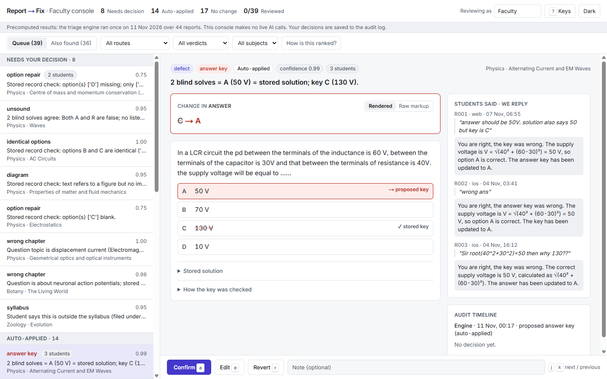
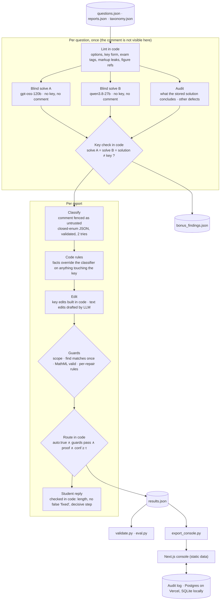

# Report → Fix

A triage engine and a faculty console for student error reports on JEE/NEET questions (Acadza AI intern
assignment; the original brief is in [`docs/ASSIGNMENT.md`](docs/ASSIGNMENT.md)).

- **Live console:** _being deployed; the link is added here once the Vercel project is live_
- **Engine output:** [`results.json`](results.json) (44 reports) · [`bonus_findings.json`](bonus_findings.json) (defects nobody reported)
- **How the AI was directed, and where it was wrong:** [`PROMPTS.md`](PROMPTS.md) · **Product thinking:** [`PRODUCT.md`](PRODUCT.md) · **Video script:** [`VIDEO.md`](VIDEO.md)



## The idea in four lines

1. The student's comment is a **lead, not an instruction**. It never reaches the solver, the auditor or the edit writer.
2. **Code decides** the key, the edit scope and the route. The LLM solves, reads and drafts.
3. An answer key changes automatically only when **two blind solves from different model families agree with each
   other and with the stored solution**, and differ from the key.
4. Anything the taxonomy marks `auto: false`, and anything that would be new authored content, **always** goes to a teacher.

## Architecture



| Path | What it is |
|---|---|
| `engine/lint.py`, `engine/guards.py`, `engine/textview.py` | Deterministic layer. No LLM. Unit-tested in `tests/`. |
| `engine/pipeline.py` | Orchestration, code rules, routing. |
| `engine/llm.py` | Provider-agnostic wrapper (Groq primary, Gemini fallback), disk cache, token log. |
| `engine/config/config.json`, `engine/config/prompts/*.txt` | Models, thresholds, stakes, prompt versions. Change behaviour here, not in code. |
| `validate.py` | Re-runs taxonomy checks and the same edit guards on `results.json`. |
| `eval.py`, `labels.json` | Per-field accuracy and unsafe auto-applies against blind labels. |
| `web/` | Faculty console (Next.js App Router, TypeScript, Tailwind, no UI kit). |
| `runs/` | LLM cache, per-run trace and usage, eval history. |

## Run it

Engine (Python 3.11+, standard library only, nothing to install):

```bash
python -m engine.pipeline --offline   # rebuilds results.json from the committed cache; no key, no network
python validate.py && python eval.py  # safety checks, then accuracy against labels.json
python -m unittest discover -s tests  # guards and lints
```

Console:

```bash
python -m engine.export_console       # results.json -> web/data/console.json
cd web && npm install
npm run dev                           # http://localhost:3000 ; audit log in SQLite unless DATABASE_URL is set
```

For a fresh (uncached) engine run, copy `.env.example` to `.env`, add `GROQ_API_KEY` (and optionally
`GEMINI_API_KEY` for fallback), and drop `--offline`. To swap provider: `LLM_PROVIDER=gemini`.

## Results

`validate.py` on the committed `results.json`: **OK** (enums valid, every edit in scope, every `find` matches
exactly once, no `auto_apply` on an `auto:false` repair).

| | Count |
|---|---|
| Verdicts | defect 27 · no_error 11 · display_issue 2 · already_fixed 1 · app_issue 1 · language_mode 1 · not_actionable 1 |
| Routes | auto_apply 18 · no_change 17 · faculty_review 9 |
| Auto-applied repairs | answer_key 6 · stem_data 3 · solution_fix 3 · spelling 2 · exam_reference 1 · markup_leak 1 · type_mismatch 1 · answer_form 1 |

`eval.py` against `labels.json` (44 labelled reports; see Limits for what these labels are):

| Run | Prompts and models | Verdict | Repair | Route | All three | Unsafe auto-applies |
|---|---|---|---|---|---|---|
| 1 (baseline) | `classify.v1` on `gpt-oss-20b`, `audit.v1`, `reply.v2` | 37/44 (84.1%) | 37/44 (84.1%) | 36/44 (81.8%) | 33/44 (75.0%) | 0 |
| 2 | `classify.v2` on `gpt-oss-120b`, `audit.v2`, skipped-solve fix, blank-keyed-option rule | 44/44 (100%) | 44/44 (100%) | 43/44 (97.7%) | 43/44 (97.7%) | 0 |
| 3 (committed) | run 2 + `reply.v3` on `qwen3.8-27b`, one shared edit per question | 44/44 (100%) | 44/44 (100%) | 43/44 (97.7%) | 43/44 (97.7%) | 0 |

Replies are not scored by `eval.py`; run 3 changed only reply text, evidence wording and edit consistency.

The one remaining disagreement is R011 (a blank option that is also the key): the label says auto-apply "1 : 1",
the engine sends it to a teacher. The engine's behaviour is kept; reasoning in [`PROMPTS.md`](PROMPTS.md) section 3.
Version-by-version changes are in section 2.

**Bonus: defects nobody reported.** `bonus_findings.json` has 36 findings. Five come from deterministic checks and
are certain: a stray `\AA` LaTeX fragment in a solution (question of R018/R019), a malformed mcq key `["", "B"]`
(R021's question), units inside the square root in all four options, `√(2 m)` for `√2 m` (R030's question), and a
stray "1." rendered before both the question and the solution by a single-item `<ol>` (R035's question). The other
31 come from the LLM audit and are leads to confirm, not verdicts; some are false positives (for example it flags
my own plain-text rendering of MathML as "raw LaTeX"). Of the 4 questions with no report at all, 3 have an audit
lead; the only substantive one is the dialysis question, whose explanation argues against its own (correct) key.

### Edit format

An edit is `{field, find, replace}`.

- **Text fields** (`question`, `solution`): `find` is a substring of the stored raw markup that occurs exactly
  once; `replace` is what it becomes.
- **Value fields** (`answer`, `questionType`): `find` and `replace` are **JSON values**, and `find` must equal the
  stored value exactly. This is what makes list and malformed keys expressible:
  `{"field": "answer", "find": ["", "B"], "replace": "B"}`.
- A `type_mismatch` repair changes two fields, so the row carries the answer change in `edit` and the
  `questionType` change in `extra_edits`. Both pass the same guards.

## Cost

**₹0.** Every call ran on free tiers (Groq, with Gemini as fallback).

| | Committed run (what a cold run of the final pipeline uses) |
|---|---|
| LLM calls | 219 for 44 reports / 43 questions (about 5 per report) |
| Tokens | 247,294 in · 76,117 out |
| Served by | Groq `gpt-oss-120b` 96 calls · Groq `qwen3.8-27b` 105 · Gemini `gemini-2.5-flash` 18 |
| What it would cost at Groq list price | $0.21 for the 201 Groq calls (about $0.005 per report); the 18 Gemini calls are not priced here |

Source: `runs/usage.json`; list prices from Groq's model page, read 10 Nov 2026 and stored in `config.json`.
Including the earlier prompt iterations, 405 responses are in `runs/llm_cache/`. Free-tier daily token caps were the
real constraint: the full run had to be resumed from cache three times.

## The console

Built for a teacher clearing a queue late in the evening: what changed, why, and act.

- **Queue** grouped by question and ranked by stakes × students reporting × confidence. Needs-decision first,
  auto-applied next (spot-check), no-change collapsed. The ranking is explained in the page.
- **Case**: chips for verdict, repair, route and confidence; one bold evidence line; the question rendered from
  sanitised HTML with native MathML; the stored key (✓) and proposed key (→) marked on the options; a word-level
  diff with a raw-markup toggle; every student comment with its reply; the audit timeline.
- **Act**: Approve / Edit / Reject in one click or with `a` `e` `r`; `j` `k` to move; `u` to undo; `?` for help.
  Updates are optimistic with an undo toast and roll back if the save fails.
- **Also found**: defects nobody reported, as leads for a teacher.
- Light and dark, one accent colour, red used only for an answer-key change. Checked at 1440px and 390px
  (`docs/screenshots/`). Lighthouse accessibility: 100 (desktop) and 98 (mobile), measured on the local production build.

## Limits (read before trusting it)

- **The labels are AI-drafted.** `labels.json` was written blind (from a hand-solve and `data/` only, before any
  engine output was looked at) by the same assistant that built the engine; disagreements were resolved by me.
  The eval is a consistency check, not an independent benchmark. Acadza's hidden ground truth is the real score.
- **44 reports is a small sample.** The prompts were iterated against these same 44. Expect lower accuracy on new
  data until there is a held-out set.
- **Mixed providers in the committed run.** Groq's free daily token cap was reached mid-run, so some calls were
  answered by the Gemini fallback (counts under Cost). Each cached response records which provider and model
  produced it.
- **Blind solves can agree and both be wrong.** Two model families reduce that risk; the stored solution as a third
  vote reduces it further; it is not zero. That is why key changes need all three and are the first thing in the
  spot-check queue.
- **No figures.** A question that needs its diagram cannot be solved blind; such cases go to a teacher.
- **Subjects covered by the data only**: Physics, Botany, Zoology. Chemistry and Maths are untested.
- **The console has no login.** "Reviewing as" is a free-text name stored with each audit entry. The API only
  accepts known question ids and the four actions, but anyone with the URL can write audit entries. A real
  deployment needs authentication.
- **Approve does not write to a question bank.** It records the decision and the exact before/after in the audit
  log; applying it to production data is out of scope here.
- **`auto_apply` means "the engine would apply this"**; in the console those cases still appear for confirmation.
